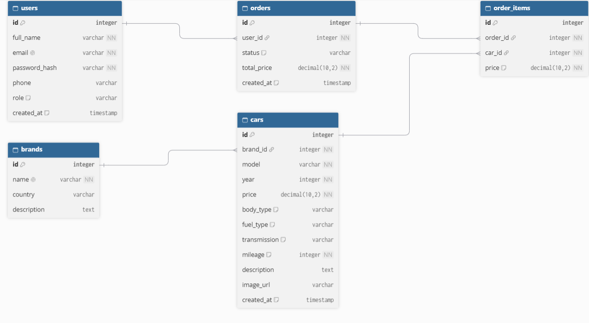

# AutoHub — Каталог та сервіс бронювання автомобілів

## 1. Опис бізнес-логіки проєкту

**AutoHub** — це веб-платформа для перегляду, підбору та оформлення замовлення на купівлю авто. Сервіс дозволяє користувачам зручно обирати транспортні засоби за потрібними характеристиками, а адміністраторам — управляти асортиментом автосалону.

### Функціонал для звичайного відвідувача (гостя):
- Перегляд каталогу наявних автомобілів із пошуком за назвою моделі.
- Фільтрація списку за брендом, типом кузова (седан, кросовер тощо) та типом палива.
- Сортування машин за зростанням/спаданням ціни, роком випуску та пробігом.
- Окрема сторінка кожного авто з детальними технічними характеристиками, описом та фото.
- Сторінка каталогу брендів та окрема сторінка бренду з усіма його наявними авто.
- Інформаційні сторінки: «Про компанію», гарантійні зобов'язання, умови оформлення та доставки.

### Функціонал для авторизованого користувача:
- Реєстрація нового облікового запису та вхід у систему.
- Перегляд та редагування контактних даних у власному профілі.
- Додавання обраних авто до кошика.
- Швидке оформлення замовлення на авто в один клік (без необхідності онлайн-оплати).
- Перегляд історії власних замовлень та їхнього поточного статусу.

### Функціонал адміністратора (менеджера):
- Додавання нових марок (брендів) авто до каталогу.
- Редагування та видалення наявних брендів.
- Додавання нових моделей автомобілів з усіма характеристиками.
- Редагування цін, пробігу та описів наявних авто.
- Видалення проданих або неактуальних позицій.
- Перегляд усіх замовлень клієнтів та зміна їхнього статусу.

---

## 2. Схема бази даних (ERD)



---

## 3. Архітектура REST API

Всі запити та відповіді передаються у форматі `JSON`. Базовий префікс для всіх маршрутів: `/api/v1`.

### 3.1. Автентифікація та Користувачі

#### Реєстрація нового користувача
- **Використання:** створення нового облікового запису покупця.
- **Метод:** `POST /api/v1/auth/register`
- **Request Body:**
  ```json
  {
    "fullName": "Іван Коваленко",
    "email": "ivan@example.com",
    "password": "strongPassword123",
    "phone": "+380671234567"
  }
  ```
- **Response Status:** `201 Created`
- **Response Body:**
  ```json
  {
    "id": 1,
    "fullName": "Іван Коваленко",
    "email": "ivan@example.com",
    "role": "client"
  }
  ```

#### Вхід у систему (Логін)
- **Використання:** авторизація та отримання токена доступу.
- **Метод:** `POST /api/v1/auth/login`
- **Request Body:**
  ```json
  {
    "email": "ivan@example.com",
    "password": "strongPassword123"
  }
  ```
- **Response Status:** `200 OK`
- **Response Body:**
  ```json
  {
    "token": "eyJhbGciOiJIUzI1NiIsInR5cCI6IkpXVCJ9...",
    "user": {
      "id": 1,
      "fullName": "Іван Коваленко",
      "email": "ivan@example.com",
      "role": "client"
    }
  }
  ```

#### Отримання профілю поточного користувача
- **Використання:** завантаження особистих даних у кабінеті користувача.
- **Метод:** `GET /api/v1/users/me`
- **Headers:** `Authorization: Bearer <token>`
- **Response Status:** `200 OK`
- **Response Body:**
  ```json
  {
    "id": 1,
    "fullName": "Іван Коваленко",
    "email": "ivan@example.com",
    "phone": "+380671234567",
    "role": "client"
  }
  ```

#### Оновлення даних профілю
- **Використання:** зміна імені чи контактного номера телефону.
- **Метод:** `PATCH /api/v1/users/me`
- **Headers:** `Authorization: Bearer <token>`
- **Request Body:**
  ```json
  {
    "fullName": "Іван Петренко",
    "phone": "+380509876543"
  }
  ```
- **Response Status:** `200 OK`
- **Response Body:**
  ```json
  {
    "id": 1,
    "fullName": "Іван Петренко",
    "email": "ivan@example.com",
    "phone": "+380509876543"
  }
  ```

---

### 3.2. Автомобілі (Каталог)

#### Отримання списку авто (з пошуком, фільтрацією та сортуванням)
- **Використання:** відображення списку машин на головній сторінці або в каталозі.
- **Метод:** `GET /api/v1/cars`
- **Query Parameters:**
  - `search` (рядок): пошук за назвою моделі (наприклад, `camry`)
  - `brandId` (число): фільтр за брендом (наприклад, `1`)
  - `bodyType` (рядок): фільтр за типом кузова (`sedan`, `suv`, `hatchback`)
  - `fuelType` (рядок): фільтр за типом палива (`petrol`, `diesel`, `electric`, `hybrid`)
  - `sort` (рядок): критерій сортування (`price_asc`, `price_desc`, `year_desc`, `mileage_asc`)
  - `page` (число, за замовчуванням `1`): номер сторінки
  - `limit` (число, за замовчуванням `12`): кількість елементів на сторінці
- **Response Status:** `200 OK`
- **Response Body:**
  ```json
  {
    "data": [
      {
        "id": 10,
        "brand": "Toyota",
        "model": "Camry",
        "year": 2021,
        "price": 24500,
        "bodyType": "sedan",
        "fuelType": "petrol",
        "mileage": 45000,
        "imageUrl": "[https://example.com/cars/camry2021.jpg](https://example.com/cars/camry2021.jpg)"
      }
    ],
    "pagination": {
      "totalItems": 1,
      "currentPage": 1,
      "totalPages": 1
    }
  }
  ```

#### Отримання детальної інформації про конкретне авто
- **Використання:** відображення картки автомобіля з усіма технічними даними.
- **Метод:** `GET /api/v1/cars/{id}`
- **Response Status:** `200 OK`
- **Response Body:**
  ```json
  {
    "id": 10,
    "brand": {
      "id": 1,
      "name": "Toyota"
    },
    "model": "Camry",
    "year": 2021,
    "price": 24500,
    "bodyType": "sedan",
    "fuelType": "petrol",
    "transmission": "automatic",
    "mileage": 45000,
    "description": "Офіційний автомобіль в ідеальному технічному стані, один власник, повна сервісна книга.",
    "imageUrl": "[https://example.com/cars/camry2021.jpg](https://example.com/cars/camry2021.jpg)"
  }
  ```

#### Додавання нового авто (Адміністратор)
- **Використання:** внесення нового автомобіля в асортимент.
- **Метод:** `POST /api/v1/cars`
- **Headers:** `Authorization: Bearer <token>`
- **Request Body:**
  ```json
  {
    "brandId": 1,
    "model": "RAV4",
    "year": 2022,
    "price": 31000,
    "bodyType": "suv",
    "fuelType": "hybrid",
    "transmission": "automatic",
    "mileage": 28000,
    "description": "Повний привід, стан нового автомобіля, максимальна комплектація.",
    "imageUrl": "[https://example.com/cars/rav4.jpg](https://example.com/cars/rav4.jpg)"
  }
  ```
- **Response Status:** `201 Created`
- **Response Body:**
  ```json
  {
    "id": 11,
    "brandId": 1,
    "model": "RAV4",
    "price": 31000,
    "status": "available"
  }
  ```

#### Оновлення даних про автомобіль (Адміністратор)
- **Використання:** зміна ціни, оновлення пробігу або опису.
- **Метод:** `PUT /api/v1/cars/{id}`
- **Headers:** `Authorization: Bearer <token>`
- **Request Body:**
  ```json
  {
    "price": 29900,
    "mileage": 29000,
    "description": "Ціну знижено! Повний комплект зимової гуми у подарунок."
  }
  ```
- **Response Status:** `200 OK`
- **Response Body:**
  ```json
  {
    "id": 11,
    "price": 29900,
    "mileage": 29000,
    "description": "Ціну знижено! Повний комплект зимової гуми у подарунок."
  }
  ```

#### Видалення авто з каталогу (Адміністратор)
- **Використання:** зняття авто з продажу чи видалення помилкового запису.
- **Метод:** `DELETE /api/v1/cars/{id}`
- **Headers:** `Authorization: Bearer <token>`
- **Response Status:** `204 No Content`

---

### 3.3. Бренди (Виробники)

#### Отримання списку всіх брендів
- **Використання:** виведення списку виробників у фільтрах та в розділі брендів.
- **Метод:** `GET /api/v1/brands`
- **Response Status:** `200 OK`
- **Response Body:**
  ```json
  [
    {
      "id": 1,
      "name": "Toyota",
      "country": "Японія",
      "carsCount": 14
    },
    {
      "id": 2,
      "name": "BMW",
      "country": "Німеччина",
      "carsCount": 8
    }
  ]
  ```

#### Отримання всіх авто обраного бренду
- **Використання:** відкриття сторінки конкретної марки з усіма наявними моделями.
- **Метод:** `GET /api/v1/brands/{id}/cars`
- **Response Status:** `200 OK`
- **Response Body:**
  ```json
  [
    {
      "id": 10,
      "model": "Camry",
      "year": 2021,
      "price": 24500,
      "bodyType": "sedan",
      "imageUrl": "[https://example.com/cars/camry2021.jpg](https://example.com/cars/camry2021.jpg)"
    },
    {
      "id": 11,
      "model": "RAV4",
      "year": 2022,
      "price": 31000,
      "bodyType": "suv",
      "imageUrl": "[https://example.com/cars/rav4.jpg](https://example.com/cars/rav4.jpg)"
    }
  ]
  ```

#### Додавання нового бренду (Адміністратор)
- **Використання:** реєстрація нової марки в каталозі.
- **Метод:** `POST /api/v1/brands`
- **Headers:** `Authorization: Bearer <token>`
- **Request Body:**
  ```json
  {
    "name": "Audi",
    "country": "Німеччина",
    "description": "Німецький преміум-виробник автомобілів."
  }
  ```
- **Response Status:** `201 Created`
- **Response Body:**
  ```json
  {
    "id": 3,
    "name": "Audi",
    "country": "Німеччина",
    "description": "Німецький преміум-виробник автомобілів."
  }
  ```

#### Оновлення бренду (Адміністратор)
- **Використання:** редагування назви або опису бренду.
- **Метод:** `PATCH /api/v1/brands/{id}`
- **Headers:** `Authorization: Bearer <token>`
- **Request Body:**
  ```json
  {
    "description": "Оновлений опис бренду та історія компанії."
  }
  ```
- **Response Status:** `200 OK`
- **Response Body:**
  ```json
  {
    "id": 3,
    "name": "Audi",
    "country": "Німеччина",
    "description": "Оновлений опис бренду та історія компанії."
  }
  ```

#### Видалення бренду (Адміністратор)
- **Використання:** видалення марки авто з каталогу.
- **Метод:** `DELETE /api/v1/brands/{id}`
- **Headers:** `Authorization: Bearer <token>`
- **Response Status:** `204 No Content`

---

### 3.4. Кошик та Замовлення

#### Створення замовлення (Бронювання/Купівля)
- **Використання:** оформлення заявки на купівлю вибраних у кошику автомобілів.
- **Метод:** `POST /api/v1/orders`
- **Headers:** `Authorization: Bearer <token>`
- **Request Body:**
  ```json
  {
    "carIds": [10]
  }
  ```
- **Response Status:** `201 Created`
- **Response Body:**
  ```json
  {
    "orderId": 105,
    "userId": 1,
    "totalPrice": 24500,
    "status": "pending",
    "createdAt": "2026-11-03T12:00:00Z"
  }
  ```

#### Перегляд історії замовлень користувача
- **Використання:** перегляд оформлених замовлень в особистому кабінеті клієнта.
- **Метод:** `GET /api/v1/orders/my`
- **Headers:** `Authorization: Bearer <token>`
- **Response Status:** `200 OK`
- **Response Body:**
  ```json
  [
    {
      "orderId": 105,
      "status": "pending",
      "totalPrice": 24500,
      "createdAt": "2026-11-03T12:00:00Z",
      "items": [
        {
          "carId": 10,
          "brand": "Toyota",
          "model": "Camry",
          "price": 24500
        }
      ]
    }
  ]
  ```

#### Перегляд усіх замовлень (Адміністратор)
- **Використання:** отримання переліку замовлень усіх клієнтів для подальшої обробки менеджером.
- **Метод:** `GET /api/v1/orders`
- **Headers:** `Authorization: Bearer <token>`
- **Response Status:** `200 OK`
- **Response Body:**
  ```json
  [
    {
      "orderId": 105,
      "userId": 1,
      "customerName": "Іван Коваленко",
      "customerPhone": "+380671234567",
      "status": "pending",
      "totalPrice": 24500,
      "createdAt": "2026-10-03T12:00:00Z"
    }
  ]
  ```

#### Зміна статусу замовлення (Адміністратор)
- **Використання:** переведення замовлення в статус "confirmed", "completed" або "cancelled".
- **Метод:** `PATCH /api/v1/orders/{id}/status`
- **Headers:** `Authorization: Bearer <token>`
- **Request Body:**
  ```json
  {
    "status": "confirmed"
  }
  ```
- **Response Status:** `200 OK`
- **Response Body:**
  ```json
  {
    "orderId": 105,
    "status": "confirmed",
    "updatedAt": "2026-10-03T12:30:00Z"
  }
  ```

---

### 3.5. Загальна інформація про компанію

#### Отримання контакту та інформації про сервіс
- **Використання:** відображення сторінки «Про нас», гарантійних правил та умов доставки.
- **Метод:** `GET /api/v1/info`
- **Response Status:** `200 OK`
- **Response Body:**
  ```json
  {
    "companyName": "AutoHub Ukraine",
    "address": "м. Київ, вул. Велика Васильківська, 100",
    "phone": "+380441234567",
    "email": "info@autohub.ua",
    "warrantyPolicy": "12 місяців гарантії або 20 000 км пробігу на кожен перевірений автомобіль.",
    "deliveryInfo": "Доставка власним автовозом у будь-яке місто України протягом 3-х робочих днів."
  }
  ```


---

## 4. Як запустити проєкт

Поточна версія бекенду реалізує каталог: моделі `Brand` та `Car`, CRUD для брендів і автомобілів, фільтрацію, сортування та пагінацію списку авто. Автентифікація, профіль, кошик і замовлення будуть додані пізніше.

### 4.1. Вимоги

- Python 3.12+ (перевірено на Python 3.13)
- Git

### 4.2. Запуск бекенду (Django + DRF)

1. **Клонуйте репозиторій та перейдіть у папку проєкту:**
   ```bash
   git clone <url-репозиторію> car-catalog-web
   cd car-catalog-web
   ```

2. **Створіть віртуальне оточення:**
   ```bash
   python -m venv venv
   ```

3. **Активуйте віртуальне оточення:**
   - Windows (PowerShell):
     ```powershell
     .\venv\Scripts\Activate.ps1
     ```
   - Windows (cmd):
     ```cmd
     venv\Scripts\activate.bat
     ```
   - Linux / macOS:
     ```bash
     source venv/bin/activate
     ```

4. **Встановіть залежності:**
   ```bash
   pip install -r requirements.txt
   ```

5. **Застосуйте міграції (створить SQLite-базу `db.sqlite3` з таблицями `brands` та `cars`):**
   ```bash
   python manage.py migrate
   ```

6. **(Необов'язково) Завантажте демонстраційні дані** — 4 бренди та 6 автомобілів:
   ```bash
   python manage.py loaddata sample_data
   ```

7. **(Необов'язково) Створіть адміністратора** для панелі http://127.0.0.1:8000/admin/:
   ```bash
   python manage.py createsuperuser
   ```

8. **Запустіть сервер розробки:**
   ```bash
   python manage.py runserver
   ```
   API буде доступне за адресою http://127.0.0.1:8000/api/v1/.

9. **(Необов'язково) Запустіть автотести:**
   ```bash
   python manage.py test catalog
   ```

### 4.3. Реалізовані ендпоінти

| Метод | Маршрут | Опис | Успіх |
|-------|---------|------|-------|
| `GET` | `/api/v1/brands/` | Список брендів з кількістю авто (`carsCount`) | `200` |
| `POST` | `/api/v1/brands/` | Створення бренду | `201` |
| `GET` | `/api/v1/brands/<id>/` | Один бренд | `200` |
| `PUT` / `PATCH` | `/api/v1/brands/<id>/` | Повне / часткове оновлення бренду | `200` |
| `DELETE` | `/api/v1/brands/<id>/` | Видалення бренду (`409`, якщо є пов'язані авто) | `204` |
| `GET` | `/api/v1/brands/<id>/cars/` | Усі автомобілі бренду | `200` |
| `GET` | `/api/v1/cars/` | Список авто з фільтрацією, сортуванням і пагінацією | `200` |
| `POST` | `/api/v1/cars/` | Створення автомобіля | `201` |
| `GET` | `/api/v1/cars/<id>/` | Один автомобіль | `200` |
| `PUT` / `PATCH` | `/api/v1/cars/<id>/` | Повне / часткове оновлення автомобіля | `200` |
| `DELETE` | `/api/v1/cars/<id>/` | Видалення автомобіля | `204` |

Параметри `GET /api/v1/cars/`: `search`, `brandId`, `bodyType`, `fuelType`, `sort` (`price_asc`, `price_desc`, `year_asc`, `year_desc`, `mileage_asc`, `mileage_desc`, `newest`), `page` (за замовчуванням `1`), `limit` (за замовчуванням `12`, максимум `100`).

### 4.4. Формат помилок

Усі ендпоінти повертають помилки `400`, `404`, `409` в єдиному форматі. Ключ `error` присутній завжди, `details` — лише для помилок валідації:

```json
{
  "error": "Помилка валідації даних.",
  "details": {
    "name": ["Це поле не може бути порожнім."]
  }
}
```

```json
{
  "error": "Неможливо видалити бренд «Toyota»: з ним пов'язано автомобілів — 2. Спочатку видаліть або перенесіть ці автомобілі до іншого бренду."
}
```

### 4.5. Frontend

Мінімальний інтерфейс знаходиться в папці [`frontend_repo/`](frontend_repo/README.md). Коротко:

```bash
cd frontend_repo
python -m http.server 5500
```

Відкрийте http://127.0.0.1:5500 (бекенд має бути запущений). CORS дозволено для `http://localhost:5500` та `http://127.0.0.1:5500`.

### 4.6. Postman

Колекція: [`postman/car_catalog.postman_collection.json`](postman/car_catalog.postman_collection.json) (формат Collection v2.1).

1. Postman → **Import** → оберіть файл колекції.
2. Змінна `{{base_url}}` за замовчуванням дорівнює `http://127.0.0.1:8000`.
3. Змінні `{{brand_id}}` та `{{car_id}}` заповнюються автоматично запитами створення, тому запускайте колекцію цілком (**Run collection**) або папки по черзі згори донизу: «Бренди» → «Автомобілі» → «Негативні сценарії» → «Видалення».
4. Кожен запит містить тести на статус-код і збережений приклад відповіді, включно з негативними сценаріями `400`, `404` та `409`.

### 4.7. Структура проєкту

```
car-catalog-web/
├── config/              # налаштування Django-проєкту (settings, urls)
├── catalog/             # застосунок каталогу: моделі, серіалізатори, APIView, тести
│   ├── fixtures/        # демонстраційні дані (sample_data.json)
│   └── migrations/      # міграції БД
├── docs/                # ER-діаграма
├── frontend_repo/       # мінімальний фронтенд (HTML/CSS/JS)
├── postman/             # Postman-колекція
├── manage.py
└── requirements.txt
```
